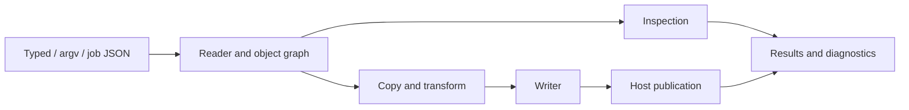

# Architecture

Lokad.qpdf is a managed PDF engine shared by typed C# operations, qpdf-style
arguments and job JSON. The engine owns PDF semantics; the application's host owns
storage and publication. The [supported profile](docs/SUPPORTED-PROFILE.md) defines
the public contract, and [compatibility](docs/COMPATIBILITY.md) records differences
from native qpdf.

## Execution flow

Argv and job JSON resolve into shared operation plans; they do not implement a
separate reader or writer. Typed operations call the same cores directly. Defaults
can differ by entry point, including recovery and stream decoding; those differences
are part of the compatibility contract.

Selection cores borrow one immutable settings value containing the existing
feature requests. Typed defaults and command-plan projection are defined once;
source documents, selective-read retries and publication owners stay explicit.
Whole-file rewrites select all pages through the existing governed range resolver
without constructing and cloning a separate page-number vector.

Every graph copier uses an explicit construction owner and the same admitted
map and name-table storage. Tests use this production path; there is no unowned
copier mode. Form-resource traversal tracks graph identities, with indirect
form guards independent of resource-scope visits.
Argv parsing and range expansion require their execution governor and construction
owners. Linearization and inline-image tests exercise the same governed indexes
and allocation batches as production; no unowned parser or dictionary adapters
provide alternate execution modes.

One resource governor spans configuration loading, reading, transformation,
serialization and publication. Results capture diagnostics and counters after
cleanup. Inspection can return text or bytes without creating a PDF output.
Output-free job inspections share the check plan and its configuration controls;
binary extraction plans handle explicit host output targets.

## Component map

| Component | Responsibility |
| --- | --- |
| [Public](src/Lokad.Qpdf/Public), [Commands](src/Lokad.Qpdf/Commands), [Jobs](src/Lokad.Qpdf/Jobs) | Public API, invocation parsing, configuration and operation plans. |
| [Syntax](src/Lokad.Qpdf/Syntax), [Reading](src/Lokad.Qpdf/Reading), [Objects](src/Lokad.Qpdf/Objects) | Byte-oriented parsing, xrefs, bounded recovery, object resolution and immutable values. |
| [Writing](src/Lokad.Qpdf/Writing) | Graph copying, identity remapping, serialization, object streams, QDF and linearization. |
| [Content](src/Lokad.Qpdf/Content), [Filters](src/Lokad.Qpdf/Filters), [Attachments](src/Lokad.Qpdf/Attachments) | Content/image transformations, stream decoding/encoding and embedded files. |
| [Json](src/Lokad.Qpdf/Json) | PDF inspection, import and update over the shared object model. |
| [Runtime](src/Lokad.Qpdf/Runtime), [Hosting](src/Lokad.Qpdf/Hosting) | Resource admission, diagnostics, cleanup and the built-in in-memory host. |

The reader handles classic, streamed, hybrid and incremental xrefs, including
compressed objects. Copies track identities per source so shared/cyclic graphs
remain coherent and object numbers from different inputs cannot collide. The
writer prepares lengths, offsets and identifiers before publication; linearization
uses a two-pass physical layout.

## Storage and ownership

[IQpdfHost](src/Lokad.Qpdf/Public/IQpdfHost.cs) supplies stable input leases and
staged output transactions. Paths identify host resources; the library has no
ambient filesystem, process or network access. The built-in host stores bytes in
memory. Physical adapters belong to applications or development tools.

The memory host can borrow a durable memory budget for retained input, staging
and publication. Replaced input storage stays charged through its last lease;
export copies have a caller owner that can outlive host disposal. Borrowed private
input snapshots and host staging retain local policy estimates without duplicate
engine admission at the shared root.

Eligible page selections read bounded ranges from classic-xref inputs. If the
selected ranges cannot support the operation, the reader retries the complete
input on the same lease with the same recovery policy, before publishing output.
Other layouts and operations retain complete reads.

Documents own their input, resolution tables and object caches. Disposal drops
private references while public immutable values remain usable. Private copies can borrow immutable
stream payloads while their operation owns the backing input through publication.
Retaining/async sinks receive independent immutable packets. Exclusive multisource
inputs transfer payload/backing admission to the job before earlier documents
close; rewritten headers borrow those immutable bytes through publication.

Failed or canceled operations discard uncommitted staging and close their leases.
A single-target failed commit preserves the prior output. Multiple outputs commit
sequentially, so a later failure can leave earlier outputs published; a close fault
after commit does not undo publication. The host defines its transaction semantics.

## Limits and cancellation

[QpdfLimits](src/Lokad.Qpdf/Public/QpdfLimits.cs) bounds input/output bytes, decoded
data, estimated memory, host operations, handles, diagnostics and nesting. Invocation options
can tighten host policy but cannot raise explicit host ceilings. Significant
storage, growth overlap and decompression receive admission before allocation.

Memory counters describe a charged working-set estimate, not CLR heap or process
RSS. Hosts must also account for their buffers, concurrent jobs and caller-retained
outputs. Unreleased charges alone do not prove retained memory. The library never
forces GC.

The optional `IQpdfMemoryHost` capability forwards the active caller-owned memory
budget to the resource governor. Shared admission batches the existing estimates
into coarse growth blocks while local limits stay binding. Caller scopes outlive
returned storage; host-private storage needs its own owner. See
[memory admission](docs/MEMORY.md) for the contract and current migration boundary.
Result wrappers, counter snapshots and versions use admitted capacity estimates
without finalizer receipts; returned metadata never roots its completed job.
Graph retention transfers construction estimates to coarse execution or caller
owners without walking object identities. Private cleanup refunds execution
storage; public document aliases remain charged to the caller's scope.

Cancellation is cooperative across bounded CPU loops, host calls and codec APIs;
there is no cumulative CPU fuel budget. Hosts use cancellation tokens for deadlines.
Structural bounds, cycle detection and decompression ceilings remain independent.
Cleanup can finish bounded retirement after cancellation. Diagnostics use bounded
stored records and actual UTF-8 message lengths. Overflow fails the job before
publication; accepted messages and a bounded terminal failure remain available.
Requested summaries are built once before publication and reused after commit.

## Dependencies and development tools

The core has no runtime NuGet dependencies. Hosts optionally implement
`IQpdfJpegCodecHost` to supply an `IQpdfJpegCodec` for grayscale/RGB processing.
The core validates frame sizes and owns sample/output buffers; codecs borrow them
for one synchronous call. `QpdfJpegCodecContext` provides cancellation
and memory reservations for private codec storage. Codecs must release their actual
storage before returning; outstanding accounting charges retire with the call.
Without a codec, JPEG pass-through works, decoding checks report skipped, and
eligible image optimization fails explicitly. CMYK/YCCK remains opaque.

Native qpdf, PdfPig and renderers serve development tests, probes and benchmarks;
they are not shipped with the library. The nonpackable
[ImageSharp adapter](tools/Lokad.Qpdf.ImageSharp) exercises the public codec contract
in tests, probes and benchmarks. See [AGENTS.md](AGENTS.md) for checks and
[benchmarks](docs/BENCHMARKS.md) for performance measurements.
