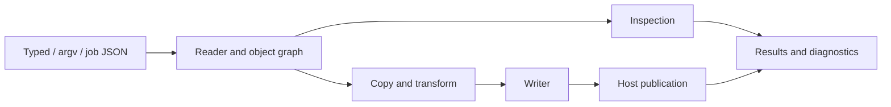

# Architecture

Lokad.qpdf is a managed PDF engine shared by typed C# operations, qpdf-style
arguments and job JSON. The engine owns PDF semantics; the application's host owns
storage and publication. The [supported profile](docs/SUPPORTED-PROFILE.md) defines
the public contract, and [compatibility](docs/COMPATIBILITY.md) records differences
from native qpdf.

Input leases expose offset-based reads into admitted caller buffers. Each lease
has one caller and one pending read at a time; completion ends the host's buffer
borrow, including on cancellation. Stable identity, length and opened bytes do
not change when a logical path is replaced. Short reads reuse destination slices;
exact readers reject invalid counts and premature zero as transport failures.

JPEG contexts lend the existing memory vocabulary to each codec call. Parent
links and aggregate counts provide subtree refunds without child registries.
The development Lokad.Image adapter only forwards interfaces; PDF boundaries
preserve admission failures through nested codec exceptions. All codec users
finish before the call owner closes. Host publication establishes surviving
storage ownership before commit and finishes pending writes before cleanup.
JPEG decode streams expose their already admitted input segment for immutable
borrowing during the call. Prepared PDF and JSON publications pass known lengths
through the existing optional host capacity hint, avoiding growth copies in the
memory host while preserving its durable storage admission.

The graph copier and overlay annotation imports share a source-specific signature
policy. It rejects signature dictionaries and populated widget/AcroForm fields
before following signature metadata into the source catalog. Private V/Parent
dictionaries do not establish field context. Inherited types are memoized by
source dictionary identity, including parent distance for cached-depth checks.
Reusable traversal lists and the cache use the copier's existing memory owner;
the source graph stays owned through output construction and publication.
Blank signature fields remain copyable. Read-only inspection retains original
values and performs no signature creation or verification. Catalog/page-tree
containment remains independent of this explicit excluded-feature outcome.

## Execution flow

Argv and job JSON resolve into shared operation plans; they do not implement a
separate reader or writer. Typed operations call the same cores directly. Defaults
can differ by entry point, including recovery and stream decoding; those differences
are part of the compatibility contract.
Job-file loading selects each property partition before sorting it, preserving
forward-prefix/reverse-suffix setter order around nested includes.
File reads fill one admitted buffer in bounded slices, including short reads;
both cancellation routes are checked before parsing the completed input.

Selection cores borrow one immutable settings value containing the existing
feature requests. Typed defaults and command-plan projection are defined once;
source documents, selective-read retries and publication owners stay explicit.
JSON and show-pages image inspection use shared page-attribute ancestry. Their
Contents probe expands arrays/nulls while ordinary stream references keep payloads unread.
PDF opening and normalized JSON creation/update use the same bounded page-tree
traversal, including indirect values, path cycle guards and nesting limits. JSON
validation borrows its mapped model and retires temporary page locations before
publication; no second counting walk approximates the reader's result.
JSON updates use the existing immutable remapping walk to validate source
generations against the borrowed xref table before merging authored zero-generation
values. Source pairs normalize without renumbering; later publication remaps the
merged graph once. Changed containers borrow their original payloads, and the
private input owner remains alive through publication. Dead source edges cannot
bind newly introduced objects merely because their numbers match.
When a primary document supplies no selected pages, the same copy loop admits its
catalog graph without adding a page group or changing source mappings. Replacement
targets the primary path independently of the selected page providers.
Ordinary selection retains the primary document's attachment collection, independent
of edits and selected page ranges. Other sources contribute page-reachable files;
their document collections require explicit attachment import. An explicit empty
primary starts without a collection, while a real zero-page input can own one.
Whole-file rewrites select all pages through the existing governed range resolver
without constructing and cloning a separate page-number vector.
Rotation and both flattening consumers resolve indirect rotation scalars through
the copied object pool before normalization; the existing reference bounds apply.
Rotation flattening isolates annotation headers shared by affected page occurrences
before changing geometry, keeping one original occurrence and borrowing appearance
payloads. Copies of widget ancestor branches join the existing form registration
and name-collision passes. Source forms are copied once before transformation;
obsolete appearance headers retire from final output roots, including catalog aliases.
The accepted deterministic-ID flag validates at parsing; plans carry no unused
flag value because deterministic identifiers are already the default.
Zero-page whole-file jobs use the same graph, catalog and attachment preparation;
zero split groups create no output transaction. Explicit page bounds still apply.

Every graph copier uses an explicit construction owner and the same admitted
map and name-table storage. Recoverable catalog, attachment and unreferenced-root copies
share a reusable, admitted source-number list: rollback removes only new mappings,
copied descendants and allocator slots, preserving earlier shared objects.
Nested name-category attempts keep their enclosing attempt's bookkeeping.
Attachment preservation enumerates raw names and specifications through the same
bounded name-tree walk used by inspection and selective extraction. Display fields
are projected only for inspection. Temporary entry arrays have a separate owner;
copied names and specification graphs keep their source admission through publication.
Removal and replacement survival is decided before copying discarded specifications,
while original and requested imported key presence still govern conflicts, including
after recoverable graph-copy failures. Recoverable copy attempts catch
malformed-data errors; retained profile, admission and host failures abort publication.
Catalog preparation resolves PageMode once, independently of generic extras and
attachment storage. Existing name bytes stay borrowed with their source ownership;
opaque values use the copier's ordinary attempts. Attachment insertion supplies
the default only when that resolved hint is absent. Split keeps named hints while
dropping opaque catalog extras under its existing policy.
After replacements, whole-file models use existing
graph reachability from the final catalog, page tree and trailer Info. Appearance
generation joins this pass when it creates replacement stream identities;
unchanged and skipped generation need no extra traversal. Coalescing
uses that same final-root pass, preserving catalog aliases held outside the page
pool and retiring only unreachable original content arrays and streams. An
operation-scoped identity cache shares the joined stream for repeated references
to the same immutable array without changing that array. Inline externalization
also retires original content from final roots after creating new stream identities;
there is no per-page pool-removal plan or source-map mutation. Content
normalization replaces page edges and keeps an original stream or array
for independent catalog, metadata or attachment roots. Its existing per-operation
cache shares replacements while the source pool version matches, including cached
failed attempts. Image optimization and Form inline conversion likewise gather
replacements
without changing original stream slots. The existing form walk redirects resource
edges and affected ancestor Forms, registering new identities before rebuilding
headers so cycles and shared bindings stay coherent. Resource headers are copied
once per dictionary identity; independent payload roots keep their originals.
No-op Form conversion keeps its existing header. These replacements join final-root
retirement. Ordinary
adds and removals need no extra graph scan. Split attachment
roots come only from the final name tree. Shared references and explicit
unreferenced-object preservation retain their existing ownership and policy.
Tests use this production path; there is no unowned
copier mode. Form-resource traversal tracks graph identities, with indirect
form guards independent of resource-scope visits.
Inline conversion requires attachment and colorspace bindings before copying
pixels. Refused conversion keeps the original bytes and refunds temporary parsing
storage; source-object preservation needs no separate candidate-preservation flag.
Inline framing reuses the object parser and reads sample dimensions or the outer
filter's packet structure. It produces no decoded samples. Normalization,
resource/appearance scans and checking use that same boundary before interpreting
more content. Unknown extents stay opaque; aborted rewrites publish no staged
image bindings. Normalization's existing cache records a resource context only
when named colorspace framing needs it, preserving ordinary stream sharing.
The tokenizer requires that known extent; the obsolete lexical lookahead and its
fallback mode are removed.
Resource pruning likewise shares the Contents reader. Its existing name sets
record actual Font/XObject uses instead of copying all declared resource names
into a combined index. Incomplete Form analysis marks the enclosing scope
uncertain before pruning; a spelling in another category cannot resolve a use.
Pruning gathers non-independent Form names before examining scoped Forms, reading
each program once per copied source. Unknown dependencies keep the examined scopes;
known inherited names protect enclosing dictionaries. Form candidates publish
through the existing resource replacement walk, preserving independent original
headers and sharing one replacement across selected pages and cyclic parents.
Retained annotation appearances with absent/null Resources conservatively keep
their page resource namespace during pruning and overlay wrapping. Generated
placement names avoid the existing XObject bindings. Other pages keep the fresh
namespace path. Imported appearances acquire their source page resources on the
existing per-placement copies; local appearance resources take precedence.
Appearance discovery examines only N/R/D and their one-level state dictionaries;
private AP entries remain opaque. Payload bytes and original headers stay shared.
Placement resolves Matrix before classifying it: non-arrays stay opaque with a
bounded warning, while malformed arrays retain their existing compatibility fallback.
Rotation uses the same N/R/D slot boundary. Annotation flattening resolves an
indirect Form subtype before deciding whether a header needs normalization;
normalization creates a fresh stream identity and keeps independent originals.
Form calculation-order arrays resolve through the copied pool before classification.
Direct and indirect arrays borrow the same owned backing into the existing source
combination and final field-closure filtering; opaque non-array extras stay opaque.
Field identity and inherited optional values likewise classify resolved nulls;
inspection keeps the existing terminal-field projection and bounded ancestry.
Cross-reference tables likewise require an explicit owner. Synthetic fixtures
admit their entry maps, trailer lists and input receipts and transfer them through
the same owned table/engine factories as production, with explicit escape and input
flags. Value scopes use the production whole-graph handoff. Object-display tests
consume the same diagnostic path as inspection; text-transfer tests use live
owned-text producers.
Argv parsing and range expansion require their execution governor and construction
owners. Linearization and inline-image tests exercise the same governed indexes
and allocation batches as production; no unowned parser or dictionary adapters
provide alternate execution modes. Filter decoders require an owned stage plan
and result scope; plans expose indexed access and struct iteration without boxed
enumeration owners.
Hint lifetime tests use typed readers and owners, with private-field inspection
for backing-storage and detachment proofs.
Codec fixtures call the live cancellation-aware implementations directly.
Canonical display, PDF JSON and resource dictionaries share governed unsigned
raw-name comparisons. QDF retains its separate escaped-name ordering.
PDF text decoding likewise requires its construction owner, governor and token;
the encoding map uses the single-byte mapping directly during initialization.
Content analysis transfers a sole materialized/decoded chunk into its joined
owner. Borrowed arrays still copy; multiple parts retain exact newline joining.
A successful join retires the chunk owner, while escaping overlay/coalesced bytes
transfer into the existing output owner before the joined owner closes.
Non-Flate codec output caches
the remaining raw ceiling per stage, accounting for PNG selectors separately
from decoded samples while retaining coarse memory admission.
Hot output writes compare the cached ceiling; sample conversion and failure
construction run only when that ceiling is exceeded.

One resource governor spans configuration loading, reading, transformation,
serialization and publication. Results capture diagnostics and counters after
cleanup. Inspection can return text or bytes without creating a PDF output.
Argv and job inspections share the check plan and its configuration controls;
binary extraction plans handle explicit host output targets. The remaining argv
parser handles writing, PDF JSON and shared option-block syntax. JSON selectors share
one configuration-owned set of numeric identities through inspection; matching
needs no canonical strings, execution clone or repeated scan of selector lists.

## Component map

| Component | Responsibility |
| --- | --- |
| [Public](src/Lokad.Qpdf/Public), [Commands](src/Lokad.Qpdf/Commands), [Jobs](src/Lokad.Qpdf/Jobs) | Public API, invocation parsing, configuration and operation plans. |
| [Syntax](src/Lokad.Qpdf/Syntax), [Reading](src/Lokad.Qpdf/Reading), [Objects](src/Lokad.Qpdf/Objects) | Byte-oriented parsing, xrefs, bounded recovery, object resolution and immutable values. |
| [Writing](src/Lokad.Qpdf/Writing) | Graph copying, identity remapping, serialization, object streams, QDF and linearization. |
| [Content](src/Lokad.Qpdf/Content), [Filters](src/Lokad.Qpdf/Filters), [Attachments](src/Lokad.Qpdf/Attachments) | Content/image transformations, stream decoding/encoding and embedded files. |
| [Json](src/Lokad.Qpdf/Json) | PDF inspection, import and update over the shared object model. |
| [Runtime](src/Lokad.Qpdf/Runtime), [Hosting](src/Lokad.Qpdf/Hosting) | Resource admission, diagnostics, cleanup and the built-in in-memory host. |

The reader handles classic, streamed, hybrid and incremental xrefs, including
compressed objects. Copies track identities per source so shared/cyclic graphs
remain coherent and object numbers from different inputs cannot collide. The
writer prepares lengths, offsets and identifiers before publication; linearization
uses a two-pass physical layout.

## Storage and ownership

[IQpdfHost](src/Lokad.Qpdf/Public/IQpdfHost.cs) supplies stable input leases and
staged output transactions. Paths identify host resources; the library has no
ambient filesystem, process or network access. The built-in host stores bytes in
memory, with separate registered-input and published-output stores. Publishing at
an input path does not change its registration; callers export and register the
output explicitly to read it as input. Physical adapters belong to applications
or development tools.

The memory host can borrow a durable memory budget for retained input, staging
and publication. Replaced input storage stays charged through its last lease;
export copies have a caller owner that can outlive host disposal. Borrowed private
input snapshots and host staging retain local policy estimates without duplicate
engine admission at the shared root.

Eligible page selections read bounded ranges from classic-xref inputs. If the
selected ranges cannot support the operation, the reader retries the complete
input on the same lease with the same recovery policy, before publishing output.
Other layouts and operations retain complete reads.
Eligibility reads the governor's existing counter values without allocating
public counter snapshots.

Documents own their input, resolution tables and object caches. Disposal drops
private references while public immutable values remain usable. Private copies can borrow immutable
stream payloads while their operation owns the backing input through publication.
Retaining/async sinks receive independent immutable packets. Exclusive multisource
inputs transfer payload/backing admission to the job before earlier documents
close; rewritten headers borrow those immutable bytes through publication.
Writer/import version carriers use private job storage. Typed checking admits its
escaping version in the existing result batch; public document version properties
keep their caller ownership. Failed private negotiation leaves no version charge.

Failed or canceled operations discard uncommitted staging and close their leases.
Host lease wrappers are allocated before acquisition. Completed host operations
return directly, so neither wrapper nor async completion metadata is allocated
after the host returns a raw lease. Pending operations retain the same cleanup.
A single-target failed commit preserves the prior output. Multiple outputs commit
sequentially, so a later failure can leave earlier outputs published; a close fault
after commit does not undo publication. The host defines its transaction semantics.

## Limits and cancellation

QDF repair keeps one immutable input and indexes object-stream lines by offsets
and lengths. Descriptor growth and numeric formatting receive coarse admission;
byte/record scans and output awaits check both cancellation routes. Outer syntax
requires LF endings while binary payloads and cross-reference bytes stay opaque.

[QpdfLimits](src/Lokad.Qpdf/Public/QpdfLimits.cs) bounds input/output bytes, decoded
data, estimated memory, host operations, handles, diagnostics and nesting. Invocation options
can tighten host policy but cannot raise explicit host ceilings. Nesting budgets,
including direct host settings, must remain within 1..499. Significant storage,
growth overlap and decompression receive admission before allocation.
Output bytes are charged cumulatively across the job's outputs, including
prepared output discarded on failure. Operations returning typed domain results
throw on cancellation; execution entry points return a canceled execution result.

Memory counters describe a charged working-set estimate, not CLR heap or process
RSS. Hosts must also account for their buffers, concurrent jobs and caller-retained
outputs. Unreleased charges alone do not prove retained memory. The library never
forces GC.

The optional `IQpdfMemoryHost` capability forwards the active caller-owned memory
budget to the resource governor. Shared admission batches the existing estimates
into coarse growth blocks while local limits stay binding. Caller scopes outlive
returned storage; host-private storage needs its own owner. See
[memory admission](docs/MEMORY.md) for the contract and current migration boundary.
Result wrappers, counter snapshots and versions use admitted capacity estimates
without finalizer receipts; returned metadata never roots its completed job.
Graph retention transfers construction estimates to coarse execution or caller
owners without walking object identities. Private cleanup refunds execution
storage; public document aliases remain charged to the caller's scope.

Cancellation is cooperative across bounded CPU loops, host calls and codec APIs;
there is no cumulative CPU fuel budget. Hosts use cancellation tokens for deadlines.
Structural bounds, cycle detection and decompression ceilings remain independent.
Cleanup can finish bounded retirement after cancellation. Diagnostics use bounded
stored records and actual UTF-8 message lengths. Overflow fails the job before
publication; accepted messages and a bounded terminal failure remain available.
Requested summaries are built once before publication and reused after commit.
Ordinary command results borrow the admitted diagnostic list without copying it
after publication; that list retains no execution owner.
Failure views cache visible counts and accepted-prefix overlap once. Reading
counts or terminal records does not repeat history searches; enumeration is linear.
Argv option recognition borrows spans. Command errors bound echoed argument text
before interpolation, including terminal parse failures outside ordinary quotas.

## Dependencies and development tools

The development file-backed probe maps missing inputs and physical I/O failures
to host outcomes. Cancellation and unexpected failures retain their own meaning;
failed acquisition closes any handle it obtained before returning an error.

The core has no runtime NuGet dependencies. Hosts optionally implement
`IQpdfJpegCodecHost` to supply an `IQpdfJpegCodec` for grayscale/RGB processing.
The core validates frame sizes and owns sample/output buffers; codecs borrow them
for one synchronous call. `QpdfJpegCodecContext` lends `CancellationToken` and
`MemoryBudget` for private codec storage. Create child scopes and use `TryReserve`
and reservation `TryResize` to admit growth and refund shrink without a second
allowance; buffer replacement must include old/new overlap. Codecs must release their actual
storage and finish all workers before returning; outstanding accounting charges
retire with the call. Worker admission and encoded-output growth share the job's
memory-accounting lock; the rest of the job retains one owner.
Without a codec, JPEG pass-through works, decoding checks report skipped, and
eligible image optimization fails explicitly. CMYK/YCCK remains opaque.

Native qpdf, PdfPig and renderers serve development tests, probes and benchmarks;
they are not shipped with the library. The nonpackable
[Lokad.Image 0.2.0 adapter](tools/Lokad.Qpdf.Image) exercises the public codec contract
in tests, probes and benchmarks. See [AGENTS.md](AGENTS.md) for checks and
[benchmarks](docs/BENCHMARKS.md) for performance measurements.

The reference helper launches native tools with argument vectors and a 30-second
deadline, preserving working directories and binary stdin/stdout/stderr. It closes
stdin after copying, terminates and awaits failed children, and settles transfers
before closing files. Both launch routes return only an exit-code record after
cleanup; no native Process escapes to reference callers.
Early input rejection retains the native nonzero exit and diagnostics; incomplete
stdin delivery to an otherwise successful command fails explicitly.
