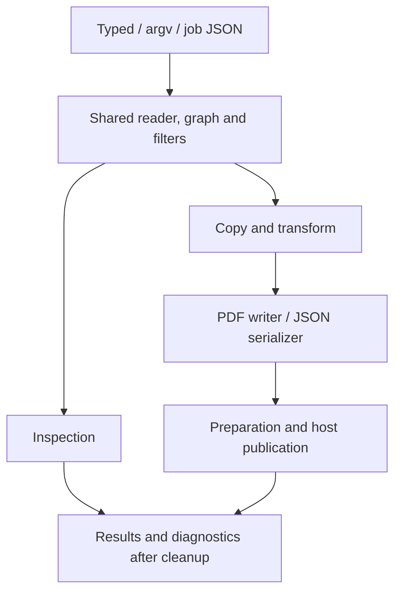

# Architecture

Lokad.qpdf is a managed PDF engine with three public entry points sharing the
same reader, immutable object model, filters, graph copier and writer. The
library owns PDF semantics and per-job resource governance. The caller's host
owns input identities, leases and publication; runtime code receives no ambient
filesystem, process or network authority.

The [supported profile](docs/SUPPORTED-PROFILE.md) defines shipped behavior,
[compatibility](docs/COMPATIBILITY.md) records native differences, and
[progress](docs/PROGRESS.md) identifies the qualified implementation.

## Execution flow

Typed operations call shared cores directly. Argv and job JSON parse into common
operation/configuration plans before calling those cores; they do not have
separate PDF implementations.

One governor spans configuration loading, reading, transformation, serialization
and publication. Inspection uses the same reader/checker/filter machinery, with
explicit decode policies. Fileless text and binary payloads return through result
objects. Outcome snapshots are captured after configuration, input and output
cleanup, preserving observed work and peaks on success, failure and cancellation.

## Host boundary and publication

[IQpdfHost](src/Lokad.Qpdf/Public/IQpdfHost.cs) opens stable input leases and creates
staged output transactions for logical paths. The host also owns any descriptor,
scratch or supplied environment facilities. The built-in in-memory host
implements these contracts; physical adapters belong to hosts or development tools.

Input/output acquisition is admitted before touching the host. Governed wrappers
charge host calls, handles, reads/writes and bytes, including short reads. Leases
and transactions close on every outcome; duplicate input opens retain publication
conflicts until the final lease closes.

Preparation validates graphs, serializes/hashes output candidates and admits
publication work and diagnostic capacity before commit. JSON closes its exclusive
reader before opening output transactions. Uncommitted staging is discarded;
a failed single-target commit preserves its previous bytes. Split/pass1 and JSON
sidecar batches publish sequentially: a later failure can leave earlier committed
outputs. A close fault after commit does not undo publication. Hosts retain
responsibility for their documented transaction semantics.

## Shared PDF components

| Component | Responsibility and useful starting point |
| --- | --- |
| Public API | [Public/](src/Lokad.Qpdf/Public) exposes typed operations, argv/job execution, limits, documents, immutable outcomes and host contracts. |
| Configuration | [Commands/](src/Lokad.Qpdf/Commands) and [Jobs/](src/Lokad.Qpdf/Jobs) share plans, ordered setters, range/label parsing and bounded response/job-file loading. |
| Parsing and resolution | [Syntax/](src/Lokad.Qpdf/Syntax), [Reading/](src/Lokad.Qpdf/Reading) and [Objects/](src/Lokad.Qpdf/Objects) handle binary syntax, xrefs, recovery, cached immutable values, inheritance and checks. |
| Graph copying | [GraphCopier.cs](src/Lokad.Qpdf/Writing/GraphCopier.cs) remaps per-source identities into a shared destination, preserving permitted sharing and excluding omitted pages. |
| Content | [Content/](src/Lokad.Qpdf/Content) tokenizes streams and implements shared resource analysis, normalization, inline images, placement, appearances and flattening. |
| Filters/codecs | [Filters/](src/Lokad.Qpdf/Filters) resolves filter chains/predictors and governs Flate, LZW, ASCII, RunLength and the ImageSharp JPEG adapter. |
| Serialization | [Writing/](src/Lokad.Qpdf/Writing) owns formatting, remapping, stream transformation, object/xref streams, QDF repair and linearization. [Json/](src/Lokad.Qpdf/Json) shares the reader/graph for PDF JSON. |
| Attachments | [Attachments/](src/Lokad.Qpdf/Attachments) shares embedded-file traversal, decoding, copying and publication. |
| Runtime/hosting | [Runtime/](src/Lokad.Qpdf/Runtime) owns resource admission, cleanup, diagnostics and execution preparation; [Hosting/](src/Lokad.Qpdf/Hosting) supplies the in-memory host. |

### Reader and graph identity

The reader resolves classic/streamed xrefs, incremental/hybrid chains and
compressed members under common work/nesting limits. Strict typed opening and
bounded CLI recovery are separate policies over the same parser. Valid stream
lengths preserve binary bytes; recovery scans stay within physical object
boundaries, charge work and observe cancellation. Repaired copies use accepted
payload lengths. Compressed members do not use file-stream recovery offsets.

Small arrays and dictionaries use bounded inline parser scratch, spilling into
governed containers as needed. Frozen results retain the shared object storage.
The object cache grows lazily; validated xref cardinality caps geometric capacity
overshoot without preallocating for unread objects.

Private typed, argv and job selections on custom hosts can prefetch bounded object ranges
from a standalone classic xref, omitting large unused extents. The same parser
and copier consume those windows. A needed omitted range, diagnostic or parse
error triggers one complete-input retry on the same open lease with the requested
recovery policy before output publication. Argv/job catalog copying and recovery
defaults remain intact; single-page and one-source range plans share this behavior.
Range plans close each accepted source before opening output, including close-fault
and one-handle hosts; speculative failures keep the lease only for fallback.
Other layouts and operations keep complete reads; public documents
and the built-in memory host retain their existing storage contracts. The full
logical input length is checked before reading, and range buffers plus short-read
assembly overlap receive memory admission.

Failed parser attempts discard their temporary values while preserving accepted
nested/cache loads. Disposal drops input, table, cache and lease references;
public immutable values and snapshots remain usable under their documented
lifetime contracts.

Exclusive single-source jobs using the built-in memory host may borrow stream slices
from immutable input storage; its output transactions consume writes synchronously.
Before a copied graph outlives its reader, the existing job scope adopts the full
input charge, including bytes outside the selected payload. Public readers keep
independent payloads, as do custom hosts that may retain write chunks.
Multisource copying also keeps independent payloads so each mostly unused input
can retire before the next reader opens. Consumers
requiring arrays materialize only the slice under
their scratch owner; serialization can borrow it through publication.

Copying memoizes identities per source, so equal object numbers from different
inputs never collide. Validated source cardinality caps source-map growth
overshoot; duplicate destination pages retain independent capacity. Selected pages register before recursive copying, allowing
forward links to later selected pages. Omitted-page links become null; duplicate
occurrences get distinct page objects while permitted resources share. Four
inheritable page attributes materialize before copying. Catalog/forms, labels,
attachments and cross-document field handling use the same copier and resource
helpers rather than route-specific engines.

### Content, filters and codecs

Content transformations share byte-oriented tokenizing and resource analysis.
Pruning preserves a page's resources when content or explicit local form scope
is unresolved. Fileless inspection keeps original resources because pruning is
a serialization operation. Overlay inspection uses the shared placement and
widget-import pipeline while preserving primary identities.

Decode policy controls which filter stages execute. Structural streams use the
shared pipeline; typed page copying can preserve opaque encodings. Flate checks
zlib framing/checksums and bounds input/output chunks. Predictors check dimensions,
output growth and row work. JPEG checks frame size/components before pixels,
uses per-job allocation owners and passes cancellation into codec APIs. Only
one-/three-component grayscale/RGB samples decode; CMYK/YCCK remains opaque with
warnings. The sole runtime package is ImageSharp **3.1.12**, hidden behind this
adapter; its temporary advisory decisions are in [development](docs/DEVELOPMENT.md).

### Writer and physical integrity

Argv/job compression/decode settings resolve in configuration order; typed
selection retains its explicit opaque-copy default. Shared stream transformation
recomputes lengths, preserves unknown encodings as allowed, and applies the
resolved encoding policy. No separate writer exists for typed, argv or job routes.

Serialization counts before emitting and verifies replay lengths. Version/ID,
object numbering, xref entries, QDF and object-stream packing use shared helpers.
Classic content IDs hash the staged prefix and original placeholder trailer;
final IDs precede commit. Other layouts retain their identifier prepass.
Linearization classifies physical parts, generates hints and replays a two-pass
layout. Classic xrefs traverse the contiguous assigned number ranges directly.
The checker compares hints with actual object ends, page runs, compressed
owners and shared/outline spans. Different valid layouts can have different hint
bytes; semantic and physical invariants decide validity.

## Resource and ownership contract

[QpdfLimits](src/Lokad.Qpdf/Public/QpdfLimits.cs) provides independent ceilings for
input/output bytes, decoded bytes, estimated memory, work, host calls/handles,
diagnostics, nesting and parser/filter controls. Invocation knobs can tighten
host policy; `--no-default-limits` cannot raise explicit host ceilings. Checked
length/offset arithmetic and admission precede significant buffer allocation,
graph growth, decompression and codec work.

`MaxMemoryBytes` is a hard ceiling on the charged per-job working-set estimate.
Live/peak counters are immutable accounting snapshots, not CLR-heap/RSS readings.
Significant payloads and growth overlap receive explicit admission; coarse
allowances cover graph/codec state. Concurrent jobs, host buffers, stable pools
and caller-retained outputs also require host policy. Unreleased charges do not
prove actual retained memory, and zero charges do not prove absence of leaks.

The implementation combines scoped owners for temporary/exclusive storage with
weak receipts for escaping immutable values. Cleanup detaches private references
and releases owned storage; receipt retirement avoids rooting completed jobs.
Receipt geometry and maintenance details are internal. Exact CLR object sizes,
individual small-object/metadata-alias receipts, fixed GC retirement rounds and
byte-precise bookkeeping accounting are not public or release requirements.
The shipped library does not force GC.

Cancellation is cooperative across work intervals, buffer loops, host operations
and codec APIs. Cleanup can finish bounded retirement after cancellation; active
work continues to observe it. Diagnostics have independent count/UTF-8 byte caps
and sanitize input, secrets, host exception details and stacks. Warning history
and presentation are prepared before publication; final immutable counters reflect
actual work and cleanup rather than unused reservations.

## Development boundary

The solution also contains ordinary tests, a package consumer, development probe
and benchmark harness. Native qpdf, PdfPig and rendering tools belong only to
explicit development validation; they never enter the shipped runtime.
No vendored engine, interop, subprocess bridge, unsafe code or ambient authority
is permitted. The library targets .NET 10 with nullable analysis and warnings as
errors.

Use the existing engine/components when fixing behavior. Validate approximate
memory with the small representative normal/adversarial workload set, preserving
meaningful limits, amplification protection, cancellation, cleanup, output
integrity and actual leak/material-growth regressions. Exact carrier audits and
historical test counts add no requirements. Focused checks and integration/release
qualification are described in [development](docs/DEVELOPMENT.md).
