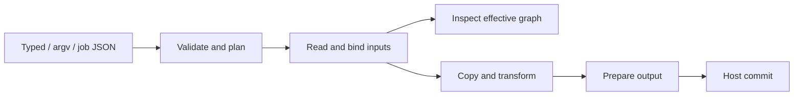

# Architecture

Lokad.qpdf uses one managed PDF pipeline for typed C#, argv and job JSON.
The engine owns PDF semantics. The application host owns storage and
publication. The supported profile defines caller behavior and compatibility
records native differences. [Supported profile](SUPPORTED-PROFILE.md) ·
[Compatibility](COMPATIBILITY.md)

## Execution flow

Argv and job JSON feed the same semantic planner. Typed methods adapt requests
to the same operation cores. The typed multi-page overloads share preparation,
result admission and cleanup. Configuration loading owns include
order, duplicate keys, encoding and retained text. Writer options are projected
after source roles are known.

Input admission and xref parsing precede authentication and page traversal.
The reader resolves classic, streamed, hybrid and incremental xrefs into
immutable values. Eligible classic-xref selection and standalone counting read
bounded ranges and fall back to complete acquisition on the same lease. Public
document opening keeps complete input for synchronous resolution. Resolution by
reference validates the complete object number and generation.

## Component map

| Component | Responsibility |
| --- | --- |
| `Public`, `Commands`, `Jobs` | APIs, configuration and operation plans. |
| `Operations` | Dispatch, source assembly, selection and inspection execution. |
| `Syntax`, `Reading`, `Objects` | Parsing, recovery, xrefs, resolution and immutable values. |
| `Content`, `Filters`, `Attachments` | Content and image transforms, codecs and embedded files. |
| `Json` | Inspection, import and update over the shared object model. |
| `Writing` | Graph copying, remapping, output models, QDF and linearization. |
| `Runtime`, `Hosting` | Admission, diagnostics, cleanup and host adapters. |

## Graph preparation

Copies preserve same-role sharing and cycles per source. Role-specific
replacements leave independent private aliases intact. Source resources, forms,
secondary actions and layer context bind while readers are open. The primary's
catalog, attachments and document protection follow their own policies. Failed
copies roll back their new objects and mappings. Final-root reachability retires
superseded graphs.

The page graph supplies inherited attributes, labels and visible page identity to
selection, transforms and inspection. Single- and multi-source selection share
appearance processing once source bindings are established. Page content and
Form operations share decoding, geometry and resource owners. Each operation
retains its policy for malformed or unsupported values.

JSON export can assemble the selected page graph before projecting it. Page and
object reports share the assembled graph and preserve source pair provenance.
New identities cannot revive invalid source edges. The export graph detaches
after serialization and sidecar copying, before host publication.

JSON creation and update bind declarations against complete pairs. An update
authenticates the source first and applies any declared page preparation before
binding. Original source edges must match live xrefs. JSON edges may refer to
live or declared pairs. Sidecars can share admitted bytes by logical path while
retaining separate headers. Output packing carries original object-stream
membership through renumbering.
Command imports use the shared coalescer during bound page-tree traversal.
Joining changes the active contents link while reachability retains private
aliases and retires replaced-only objects.

PDF publication unregisters signature fields and removes their active
attributes. Former widgets become static stamps using their stored appearances.
Signature discovery follows each field's Parent/Kids component. Its results
preserve unrelated fields and private aliases. Interactive fields and page
content share reachable resources under the same graph ownership rules.
Read-only inspection keeps source values.

## Inspection and publication

The structural checker shares page-tree, stream, content and form analysis
across ordinary and bound JSON graphs. Physical header, offsets and
linearization require physical input. Output-free JSON checking reports those
stages as skipped. Standalone and checked listings share the bound graph and
declared pairs. Attachment inspection uses the same name-tree walker on bound
and physical graphs. Text and JSON page reports share inherited image lookup
and retain their distinct descriptor and diagnostic policies.

JSON imports and ordinary PDF operations share catalog and version policy.
Whole-file command imports compact the published numbers after stream
preparation. Original pairs still identify QDF comments, and packing and
encryption use the final numbers.
Split imports partition the bound page tree after applying patches and stream
preparation. They reuse the ordinary split numbering and publication owners.
`OutputModelPreparation` finalizes reachability, encryption numbering,
ordering and object-stream grouping. Direct outline roots gain an indirect
identity for layout. Two-pass linearization classifies page and shared
dependencies before writing hints and keeps the outline closure outside packed objects.

`OutputSerialization` dispatches counting, identifier replay and final
emission. Writers share identifier validation, byte encoding and bounded
sink writes. `OutputPublication` owns staged captures. Output preparation
and result admission finish before the first commit. The publication check
uses identities collected during input acquisition, including leases already
closed. In-place JSON updates retain admitted reader storage after closing
the source lease. [Publication rules](SUPPORTED-PROFILE.md#governance)

Result-only JSON inspection with none/inline stream data needs no output
transaction. Targeted binary extraction can transfer admitted payload backing
past reader cleanup through commit. Other I/O borrows stay scoped to their
actual consumers.

## Password security

The shared reader validates the encryption dictionary and authenticates before
traversing encrypted objects. It decrypts strings and streams before caching
and object streams before parsing their members. Physical xref sections are
tracked by offset across revisions and hybrid links. The xref sections,
encryption dictionary and signature Contents remain clear. Metadata follows
its encryption flag. External-file streams stay opaque.

AES, hashes and randomness use .NET system cryptography. The owned RC4
primitive is checked against published vectors. AES verifies padding before
allocating exact plaintext and processes bounded chunks. Derivation and
payload scratch follow their owners and secret buffers clear at retirement.
[RFC 6229](https://www.rfc-editor.org/rfc/rfc6229.txt) ·
[ISO R6 algorithm errata](https://pdf-issues.pdfa.org/32000-2-2020/clause07.html#7.6.4.3.4)

Each input authenticates with its own credential. An output security owner
holds the key and dictionary independently of reader lifetime. Preservation
and templates copy password entries and the first identifier. Fresh R6 split
outputs receive independent keys.
The writer negotiates the required PDF version for the chosen handler.
[Password profile](SUPPORTED-PROFILE.md#password-security)

Crypt-stage validation and header reconstruction are shared. Protection
applies after compression and final numbering. R2–R4 per-object keys use that
final identity. Packed members share the containing stream's encryption
boundary. Length-only output passes count IVs, padding and encoded lengths
without deriving object keys or producing ciphertext.

Authenticated JSON export uses plaintext values. Update binds plaintext edits
to an authenticated source. A new graph's encryption declaration cannot
authenticate a key by itself. Encryption reports and predicates use their own
metadata-only path. [JSON security](SUPPORTED-PROFILE.md#authenticated-json-updates-and-creation)

## Storage and ownership

`IQpdfHost` supplies stable input leases and staged output transactions.
Core paths are logical keys, and physical I/O belongs to the host. Coarse
owners fund scratch, graph values, host storage and escaped results.
Borrowed buffers stay funded until the last consumer or pending I/O finishes.
[Memory ownership](MEMORY.md)

## Limits and cancellation

One governor spans planning, reading, transforms, serialization and publication.
It enforces structural, memory, decoded-byte and handle limits and optional host
admission. It bounds diagnostics and accounts for actual host operations.
Cancellation is checked at I/O boundaries and in bounded work loops.

Operation-local reuse indexes serve traversal, content analysis and decoded
streams. Destination lookups reuse observed, disjoint child ranges and
visit irregular or unseen siblings in source order. Reuse respects graph
identity and processing context. Active-path
cycle checks, depth and quota checks still apply on replay, and each page
retains its own validation. Memory charges follow backing ownership past
cache eviction when a consumer still borrows the data.

## Development

The core has no runtime NuGet dependencies. Hosts can supply JPEG codecs
through `IQpdfJpegCodecHost`. The development adapter uses Lokad.Image.
Ordinary tests need no native tools. Explicit reference and visual lanes
require their selected tools. [Codec ownership](MEMORY.md#jpeg-codecs) ·
[Verification commands](COMPATIBILITY.md#how-compatibility-is-verified)

Shared semantic owners carry exhaustive cases. Adapter tests sample wiring
and recording hosts observe resource and publication boundaries.
[Test ownership guide](https://github.com/Lokad/qpdf/blob/master/tests/Lokad.Qpdf.Tests/README.md) ·
[Benchmarks](BENCHMARKS.md)
