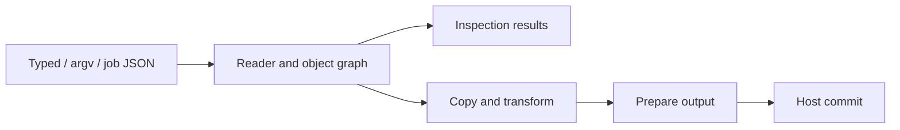

# Architecture

Lokad.qpdf uses one managed PDF pipeline for typed C#, argv and job JSON.
The engine owns PDF semantics; the application host owns storage and publication.
The [supported profile](SUPPORTED-PROFILE.md) defines scope;
[compatibility](COMPATIBILITY.md) records defaults and native differences.

## Execution flow

Argv and job JSON produce operation plans; typed methods call the same cores.
The reader resolves classic, streamed, hybrid and incremental xrefs into immutable
PDF values. Eligible selections read bounded ranges from classic-xref inputs,
falling back to a complete read on the same lease when necessary.
The writer prepares numbering, lengths, offsets and identifiers before publication;
linearization uses two passes.

## Component map

| Component | Responsibility |
| --- | --- |
| `Public`, `Commands`, `Jobs` | APIs, configuration and operation plans. |
| `Syntax`, `Reading`, `Objects` | Parsing, xrefs, recovery, resolution and immutable values. |
| `Writing` | Graph copying, remapping, serialization, QDF and linearization. |
| `Content`, `Filters`, `Attachments` | Content/image transforms, codecs and embedded files. |
| `Json` | Inspection, import and update over the shared object model. |
| `Runtime`, `Hosting` | Resource admission, diagnostics, cleanup and host adapters. |

## Graph copying

Copies track identities per source, preserving sharing and cycles. Transforms
replace recognized PDF roles while independent private aliases retain originals.
Source resources and context bind before their readers close. Primary-document
metadata and attachments are independent of selected page sources.
Final-root reachability retires superseded graphs; failed copy attempts roll back
new objects and mappings without disturbing earlier shared copies.

Signed inputs use a separate field-role mapping within the same copier. Annotation
and AcroForm edges unregister signature fields and disable their attributes before
following their values. Former widgets become static stamp annotations;
appearance/resource payloads and private aliases use the ordinary graph mapping.
Placement and JSON publication reuse this policy. Reading and inspection retain
the original immutable values and do not validate signatures.

The internal revision 6 authentication primitive uses system AES/SHA and bounded,
cleared derivation scratch, checked against recorded native keys and the
[ISO 32000-2 algorithm errata](https://pdf-issues.pdfa.org/32000-2-2020/clause07.html#7.6.4.3.4).
The AES payload primitive checks padding before allocating an exact plaintext
buffer and uses bounded CBC calls so cancellation can interrupt large payloads.
The internal reader owns one authenticated key and decrypts physical objects
before caching them; object-stream members are parsed only after their container
decrypts. It consumes explicit Crypt stages and respects separate string, stream
and embedded-file filters, document metadata, xref and signature exceptions.
Recorded encrypted fixtures cover classic/streamed xrefs, hybrid supplements,
incremental replacement of strings, and an incremental update over a hybrid file.
They verify newest-object selection while older encrypted stream payloads remain readable.
`QpdfDocument.OpenAsync` and typed structural checks use this authenticated reader
with per-input text or raw credentials and non-secret encryption facts. Output-free
argv/job inspections pass the primary text credential to the same reader.
Transformations and JSON export retain their encrypted-input refusal pending integration.
R4 authentication uses system MD5 and a bounded, owned RC4 primitive, checked
against native keys and [independent RFC 6229 vectors](https://www.rfc-editor.org/rfc/rfc6229.txt).
AES-128 uses a temporary per-object key including its number and generation;
object-stream members reuse their container's plaintext. Text credentials try
UTF-8 and then a bounded PDFDocEncoding alternative; raw bytes never take that path.

## Storage and ownership

`IQpdfHost` supplies stable input leases and staged output transactions. Paths are
logical keys; core uses no ambient filesystem, processes, environment or network.
Input reads borrow caller-owned buffers until completion. Opened identity, length
and bytes remain stable through lease disposal.

Coarse owners fund execution scratch, retained graphs, host storage and escaped
results. Immutable payloads can be borrowed while their backing owner lives;
actual copies and buffer-growth overlap require admission. Pending I/O and workers
finish before cleanup refunds storage. See [memory ownership](MEMORY.md).

Outputs and result state are prepared before commit. Failed or canceled preparation
discards staging. A failed single-target commit preserves prior bytes; multiple
targets commit sequentially, and later failures do not undo earlier commits.

## Limits and cancellation

One governor spans configuration, reading, transforms, serialization and publication.
It enforces local limits and a host's optional shared memory allowance. Estimates
describe working storage, not CLR heap or process RSS. Structural, cycle and
decompression bounds remain independent of cooperative cancellation; there is no
cumulative CPU fuel. Diagnostics have bounded storage and explicit overflow.

## Development

The core has no runtime NuGet dependencies. Hosts supply JPEG codecs through
`IQpdfJpegCodecHost`; calls borrow the execution budget and cancellation token.
The nonpackable Lokad.Image adapter supplies development codecs.

Physical I/O adapters, native qpdf, renderers and PdfPig belong to development
tools and tests. Ordinary tests work without native tools; explicit reference
jobs require them. See [benchmarks](BENCHMARKS.md) for performance evidence.
