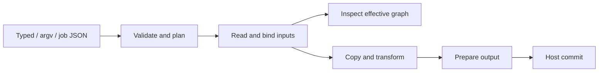

# Architecture

Lokad.qpdf uses one managed PDF pipeline for typed C#, argv and job JSON.
The engine owns PDF semantics. The application host owns storage and
publication. The supported profile defines caller behavior and compatibility
records native differences. [Supported profile](SUPPORTED-PROFILE.md) ·
[Compatibility](COMPATIBILITY.md)

## Execution flow

Argv and job JSON feed the same semantic planner. Typed methods adapt requests
to the same operation cores. The typed multi-page overloads share preparation,
result admission and cleanup. Configuration loading owns include
order, duplicate keys, encoding and retained text. Plans carry the parsed object
selector to the inspection resolver. Writer options are projected after source
roles are known.

Input admission and xref parsing precede authentication and page traversal.
The reader resolves classic, streamed, hybrid and incremental xrefs into
immutable values and validates the object number and generation of each reference.
The input profile defines when selection and counting can use bounded reads.
[Input profile](SUPPORTED-PROFILE.md#input-profile)

## Component map

| Component | Responsibility |
| --- | --- |
| `Public`, `Commands`, `Jobs` | APIs, configuration and operation plans. |
| `Operations` | Dispatch, source assembly, selection and inspection execution. |
| `Syntax`, `Reading`, `Objects` | Parsing, recovery, xrefs, resolution and immutable values. |
| `Content`, `Filters`, `Attachments` | Content and image transforms, codecs and embedded files. |
| `Json` | Inspection, import and update over the shared object model. |
| `Writing` | Graph copying, remapping, output models, QDF and linearization. |
| `Runtime`, `Hosting` | Admission, diagnostics, cleanup and host adapters. |

## Graph preparation

Copies preserve same-role sharing and cycles per source. Role-specific
replacements leave independent private aliases intact. Source resources, forms,
secondary actions and layer context bind while readers are open. The primary's
catalog, attachments and document protection follow their own policies. Failed
copies roll back their new objects and mappings. Final-root reachability retires
superseded graphs.

The page graph supplies inherited attributes, labels and page identity across
selection, transforms and inspection. Page content, Forms and appearances share
decoding, geometry and resource owners. Placement and clipping share appearance
traversal and own their stream transforms and caches.
Rotation baking shares validated page content between annotation isolation
and wrapping, borrowing the original stream sequence from the copied graph.

JSON reports preserve declared or source pairs from the effective graph. Imports
bind complete pairs, and physical source edges resolve against live xrefs.
Updates authenticate and prepare source pages before binding the patch. Sidecars
can share admitted bytes while retaining separate headers. The export graph
detaches after serialization and sidecar copying, before publication.
[JSON export](SUPPORTED-PROFILE.md#json-export) ·
[JSON import and update](SUPPORTED-PROFILE.md#json-import-and-update)

During publication, signature discovery follows each field's Parent/Kids
component and preserves unrelated fields and private aliases. Former widgets
become static stamps using their stored appearances.
[Signed-input policy](SUPPORTED-PROFILE.md#signed-inputs-and-exclusions)

## Inspection and publication

Checking and listing use the same effective graph. Physical checks use the
acquired file. Checking reuses successful page tokenization by stream order
and inline-image resource context. A job shares hint analysis across its
structural check and linearization reports. Attachment reports share a
name-tree walker, and page reports share inherited image lookup.
[Inspection profile](SUPPORTED-PROFILE.md#inspection-profile)

JSON imports and ordinary writes share catalog, version and split policies.
Split preparation binds each page range to its target before validation.
`OutputModelPreparation` finalizes reachability, numbering and object-stream
membership after stream preparation. QDF comments use original pairs. Packing
and encryption use final numbers. Two-pass linearization assigns page and shared
dependencies to hint spans and keeps outline objects outside object streams.

`OutputSerialization` dispatches counting, identifier replay and emission.
`OutputPublication` owns staged captures. Alias checks use the acquisition records.
[Publication rules](SUPPORTED-PROFILE.md#governance) · [Host transaction flow](MEMORY.md#host-transaction-flow)

## Password security

The shared reader validates the encryption dictionary and authenticates before
traversing encrypted objects. It decrypts strings and streams before caching
and object streams before parsing their members. Physical xref sections are
tracked by offset across revisions and hybrid links. The xref sections,
encryption dictionary and signature Contents remain clear. Metadata follows
its encryption flag. External-file streams stay opaque.

AES, hashes and randomness use .NET system cryptography. The owned RC4
primitive is checked against published vectors. AES verifies padding before
allocating exact plaintext and processes bounded chunks.
[RFC 6229](https://www.rfc-editor.org/rfc/rfc6229.txt) ·
[ISO R6 algorithm errata](https://pdf-issues.pdfa.org/32000-2-2020/clause07.html#7.6.4.3.4)

The output security owner holds the key and dictionary independently of the
reader. The writer negotiates the required version for the chosen handler.
[Password profile](SUPPORTED-PROFILE.md#password-security) ·
[Key and scratch ownership](MEMORY.md#engine-guarantees-and-limits)

Crypt-stage validation and header reconstruction are shared. Protection
applies after compression and final numbering. R2–R4 per-object keys use that
final identity. Packed members share the containing stream's encryption
boundary. Length-only output passes count IVs, padding and encoded lengths
without deriving object keys or producing ciphertext.

Authenticated JSON export uses plaintext values. Update binds plaintext edits
to an authenticated source. A new graph's encryption declaration cannot
authenticate a key by itself. Encryption reports and predicates use their own
metadata-only path. [JSON security](SUPPORTED-PROFILE.md#authenticated-json-updates-and-creation)

## Storage and ownership

`IQpdfHost` supplies stable input leases and staged output transactions.
Core paths are logical keys, and physical I/O belongs to the host.
[Memory ownership](MEMORY.md)

## Limits and cancellation

One governor spans planning, reading, transforms, serialization and publication.
The same limits and cancellation token apply throughout the execution.

Operation-local indexes reuse traversal, content analysis and decoded streams
by graph identity and processing context. Cache hits preserve active-path
cycle checks, depth and quota checks, and per-page validation.
[Caller limits](SUPPORTED-PROFILE.md#governance)

## Development

The core has no runtime NuGet dependencies. Hosts can supply JPEG codecs
through `IQpdfJpegCodecHost`. The development adapter uses Lokad.Image.
Ordinary tests need no native tools. Explicit reference and visual lanes
require their selected tools. [Codec ownership](MEMORY.md#jpeg-codecs) ·
[Compatibility verification](COMPATIBILITY.md#how-compatibility-is-verified)

Shared semantic owners carry exhaustive cases. Adapter tests sample wiring
and recording hosts observe resource and publication boundaries.
[Test ownership guide](https://github.com/Lokad/qpdf/blob/master/tests/Lokad.Qpdf.Tests/README.md) ·
[Benchmarks](BENCHMARKS.md)
