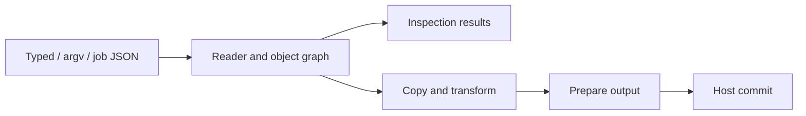

# Architecture

Lokad.qpdf uses one managed PDF pipeline for typed C#, argv and job JSON.
The engine owns PDF semantics; the application host owns storage and publication.
The [supported profile](SUPPORTED-PROFILE.md) defines scope;
[compatibility](COMPATIBILITY.md) records defaults and native differences.

## Execution flow

Argv syntax and job JSON feed one semantic planner; typed methods call the same
operation cores and validation. Argv supplies direct settings without serialized
JSON. Actual JSON retains its admitted documents and copied text through plan
consumption, including ordered nested-file loading. Scoped syntax helpers handle
page, placement, attachment and encryption blocks.
Typed single-input page selection can explicitly choose the shared bounded repair
policy; existing typed overloads retain strict parsing. Recovery warnings flow
through the existing result snapshot and publication owner.
The reader resolves classic, streamed, hybrid and incremental xrefs into immutable
PDF values. Eligible selections read bounded ranges from classic-xref inputs,
falling back to a complete read on the same lease when necessary.
Standalone page-count inspection shares this bounded prefetch and page-tree walk;
`CountPagesAsync` returns only the validated count, warnings and final counters.
Public document objects continue to use complete input so their synchronous object
resolver remains available after opening. Mixed inspections and transformed counts
retain their complete graph preparation.
Input admission and xref parsing form one stage before authentication and page
traversal; callers retain host-lease ownership through success and cleanup.
The writer prepares numbering, lengths, offsets and identifiers before publication;
linearization uses two passes.
`OutputModelPreparation` finalizes assembled and split graphs through shared
reachability, encryption numbering, ordering and object-stream grouping.
Catalog contents, version requirements and original-ID inversion have separate
internal owners; source copying supplies their data without duplicating policy.

## Component map

| Component | Responsibility |
| --- | --- |
| `Public`, `Commands`, `Jobs` | APIs, configuration and operation plans. |
| `Operations` | Job dispatch, selection, source assembly and inspection execution. |
| `Syntax`, `Reading`, `Objects` | Parsing, xrefs, recovery, resolution and immutable values. |
| `Writing` | Graph copying, remapping, serialization, QDF and linearization. |
| `Content`, `Filters`, `Attachments` | Content/image transforms, codecs and embedded files. |
| `Json` | Inspection, import and update over the shared object model. |
| `Runtime`, `Hosting` | Resource admission, diagnostics, cleanup and host adapters. |

The public facade validates and adapts requests. Single-source selection keeps
its selective-reader retry boundary and lightweight copier; multi-source assembly
coordinates primary-source policy, per-input credentials and split occurrences.
Page, label and attachment assembly share their graph helpers with inspection
projection. `OutputPublication` owns identifier preparation, serializers and staged
captures; split captures finish before any target commits.
Text and JSON page inspection share sorted image bindings from inherited resources;
their dimension diagnostics and raw JSON descriptor projections remain distinct.
Counting, identifier replay and final bytes share `OutputSerialization` format
dispatch while keeping their transaction and buffer lifetimes separate.
Job execution translates exceptions once at its enclosing result/presentation
boundary. The governor coordinates result admission and completion with the same
coarse storage owner, keeping all result capacity available before publication.

## Graph copying

Copies track identities per source, preserving sharing and cycles. Transforms
replace recognized PDF roles while independent private aliases retain originals.
Source resources and context bind before their readers close. Primary-document
metadata and attachments are independent of selected page sources.
Final-root reachability retires superseded graphs; failed copy attempts roll back
new objects and mappings without disturbing earlier shared copies.

Signed inputs use a separate field-role mapping within the same copier. Annotation
and AcroForm edges unregister signature fields and disable their attributes before
following their values. Former widgets become static stamp annotations;
appearance/resource payloads and private aliases use the ordinary graph mapping.
Placement and JSON publication reuse this policy. Reading and inspection retain
the original immutable values and do not validate signatures.
Signature discovery caches each field's Parent/Kids component independently,
including when entered through distinct annotation arrays. Array results combine
those components without marking an unrelated ordinary field as signed.
Retained form fields share one resource closure, so independent roots visit shared
appearances once. Field survival and registration order remain separate; the
closure union retains container, memory and cancellation bounds.
Single- and multi-source selection share post-overlay appearance reachability,
generation completion and flattening decisions in `PageAssembly`. Source binding
and field pruning remain with each caller; the shared operation borrows form
lists and creates no generation graph when appearance work is unnecessary.

Content transforms share rectangle bounds, matrix composition and finite numeric
array extraction in `PdfGeometry`. Feature callers retain clipping, coordinate
order, malformed-value diagnostics and degenerate-box fallbacks.

## Password security

One security handler serves the shared reader and all entry points. The reader
validates the encryption dictionary before traversing encrypted objects, then
owns one authenticated file key. Physical strings and streams decrypt before
caching; object streams decrypt once, before their members parse. Xref data,
encryption dictionaries and signature Contents remain clear. Metadata follows
its encryption flag, explicit Crypt stages are consumed once, and external-file
streams stay opaque without opening their referenced paths.

| Handler | Authentication and payload handling |
| --- | --- |
| R2/R3 | MD5/password padding and owned RC4; 40-bit R2 and 40..128-bit R3 keys. Short R3 owner keys accept the two documented full-digest/key-length conventions. |
| R4 | Legacy authentication with independent per-object keys for RC4/AES-128 strings, streams and embedded files. AES includes its object-key salt. |
| R5 | SHA-256 authentication and AES-256 payloads; preserved/copied output retains revision 5. |
| R6 | Bounded AES/SHA derivation and AES-256 payloads; all newly created protection uses revision 6. |

AES, hashes and randomness use .NET system cryptography. The owned RC4 primitive
is checked against [RFC 6229](https://www.rfc-editor.org/rfc/rfc6229.txt);
R6 derivation follows the
[ISO algorithm errata](https://pdf-issues.pdfa.org/32000-2-2020/clause07.html#7.6.4.3.4).
Recorded native keys and dictionary entries supplement roundtrip tests.
Length-only writer passes measure encrypted hex strings and padded stream lengths
without deriving object keys, generating IVs or allocating ciphertext. They share
stream exception policy with emission and retain QDF's indirect length objects.
Identifier hashing and layout passes that need actual bytes still produce them;
final encryption follows compression and uses the final physical object numbers.
Payload AES checks padding before allocating exact plaintext, processes bounded
CBC chunks for cancellation and admits exact ciphertext including IV/padding.
Key and derivation buffers remain owned and clear when their lifetimes end.

Credentials belong to each input. Typed raw bytes stay exact and borrowed;
text and command credentials try the supplied representation first, then at most
nine distinct UTF-8/PDFDoc/WinAnsi/MacRoman alternatives. Well-formed BOM-marked
UTF-16 can recover to a single-byte encoding. Recovery shares the appearance
text tables, uses bounded cleared scratch and can be suppressed globally by
commands. Authentication consumes at most 32 legacy or 127 modern bytes.
Password files retain a 512-byte recovery prefix and 512-byte read scratch,
funded through asynchronous close. Separate setter candidates preserve the
previous credential for an empty file. The logical descriptor `-` uses the
ordinary stable host lease; core never reads ambient stdin.

The output policy prepares an independent key/dictionary owner before writing.
Preservation and authenticated templates copy both password entries and the first
file identifier without retaining either password. R2/R3 keep RC4; R4 normalizes
to AES-128; R5/R6 retain their revision. New R6 creates a random file key, salts
and password entries, with explicit permissions and metadata treatment. Output
version negotiation enforces the chosen handler's PDF version/extension. Failure
never falls back to plaintext. Freshly protected split files get independent keys.

The primary input controls preservation; page, attachment, placement and template
sources authenticate independently. Copied objects outlive their source readers
and receive the output owner's protection. Repeated sources validate credential
consistency. Typed operations, argv and job JSON use this same ownership path;
argv encryption blocks feed the shared planner and preserve setter order.

Writers encrypt after compression and final object numbering. R2–R4 per-object
keys use the final number/generation and clear after ciphertext preparation.
Object-stream members reuse the container boundary, while xref streams and
security exceptions stay clear. Classic, QDF and two-pass linearized writers
count IVs, padding and encoded lengths before publication. Prepared buffers stay
admitted through pending host writes; copied keys survive source-reader disposal.

Authenticated JSON exports plaintext values and non-secret encryption facts.
Updates authenticate the source PDF before applying a plaintext patch and an
explicit output policy. JSON creation requires remove/create/template handling
for an encryption declaration; JSON alone cannot authenticate a key. Reports and
predicates may inspect declared settings without traversing pages, but content
operations require successful authentication. See the
[supported profile](SUPPORTED-PROFILE.md) for public contracts and
[compatibility](COMPATIBILITY.md) for named native differences.

## Storage and ownership

`IQpdfHost` supplies stable input leases and staged output transactions. Paths are
logical keys; core uses no ambient filesystem, processes, environment or network.
Input reads borrow caller-owned buffers until completion. Opened identity, length
and bytes remain stable through lease disposal.

Coarse owners fund execution scratch, retained graphs, host storage and escaped
results. Immutable payloads can be borrowed while their backing owner lives;
actual copies and buffer-growth overlap require admission. Pending I/O and workers
finish before cleanup refunds storage. See [memory ownership](MEMORY.md).

Outputs and result state are prepared before commit. Failed or canceled preparation
discards staging. A failed single-target commit preserves prior bytes; multiple
targets commit sequentially, and later failures do not undo earlier commits.

## Limits and cancellation

Structural checking shares decoded stream bytes between its stream and page
stages. Its operation-local cache keeps at most 32 entries and 1 MiB (also capped
at one sixteenth of the working-memory limit), with 256 KiB per entry. Current-page
chunks pin borrowed arrays until validation finishes. Evicted or oversized streams
use ordinary admitted decoding; every page still validates its own resources.
Decoded counters charge actual decoding, including work after eviction.

One governor spans configuration, reading, transforms, serialization and publication.
It enforces local limits and a host's optional shared memory allowance. Estimates
describe working storage, not CLR heap or process RSS. Structural, cycle and
decompression bounds remain independent of cooperative cancellation; there is no
cumulative CPU fuel or host-call quota. Host-operation counters observe actual
opens, reads and writes. Publication reserves reusable wrapper/staging storage,
without predicting how many calls a host needs. Diagnostics have bounded storage
and explicit overflow.

## Development

The core has no runtime NuGet dependencies. Hosts supply JPEG codecs through
`IQpdfJpegCodecHost`; calls borrow the execution budget and cancellation token.
Four-component decoding requires the codec's `SupportsCmykDecoding` opt-in;
its C/M/Y/K samples retain PDF polarity and share the existing admitted decode
buffer. The nonpackable Lokad.Image adapter supplies development codecs and
uses explicit non-inverting CMYK decoding. Image optimization still admits only
Gray/RGB encoding.

Physical I/O adapters, native qpdf, renderers and PdfPig belong to development
tools and tests. Ordinary tests work without native tools; explicit reference
jobs require them. See [benchmarks](BENCHMARKS.md) for performance evidence.

Tests assign exhaustive syntax/repair and known-answer security tables to their
primitive owners. Reader/writer workflows retain representative repairs, limits,
source roles and API wiring. Preserved physical-layout fixtures each reach their
validator; classic/streamed, valid/invalid and opaque-stream controls cover route
adaptation. Graph/content, writer layout, ownership/publication, native/visual
evidence and installed consumers retain their separate guarantees.

Presentation count/byte boundaries cover every output shape at a primary route;
selected flag combinations and decimal/culture boundaries have their own controls.
Route wiring does not replay every quota, compression and failure combination.
Publication ownership exhausts shared host boundaries, then covers additional
sources, splits, sidecars, encryption and committed outputs explicitly.

Recording hosts and caller budgets observe actual suspended I/O, admission,
refunds and immutable exported counters. Focused internal owners test exact
reservation/refusal behavior and warning preparation. A few isolated weak-reference
controls check CLR retention that admission alone cannot prove; they inspect core
owners, without traversing compiler frames or private BCL collection fields.
