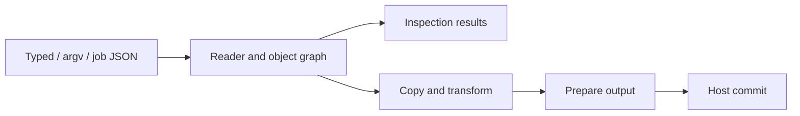

# Architecture

Lokad.qpdf uses one managed PDF pipeline for typed C#, argv and job JSON.
The engine owns PDF semantics; the application host owns storage and publication.
The [supported profile](SUPPORTED-PROFILE.md) defines scope;
[compatibility](COMPATIBILITY.md) records defaults and native differences.

## Execution flow

Argv and job JSON produce operation plans; typed methods call the same cores.
The reader resolves classic, streamed, hybrid and incremental xrefs into immutable
PDF values. Eligible selections read bounded ranges from classic-xref inputs,
falling back to a complete read on the same lease when necessary.
Input admission and xref parsing form one stage before authentication and page
traversal; callers retain host-lease ownership through success and cleanup.
The writer prepares numbering, lengths, offsets and identifiers before publication;
linearization uses two passes.

## Component map

| Component | Responsibility |
| --- | --- |
| `Public`, `Commands`, `Jobs` | APIs, configuration and operation plans. |
| `Syntax`, `Reading`, `Objects` | Parsing, xrefs, recovery, resolution and immutable values. |
| `Writing` | Graph copying, remapping, serialization, QDF and linearization. |
| `Content`, `Filters`, `Attachments` | Content/image transforms, codecs and embedded files. |
| `Json` | Inspection, import and update over the shared object model. |
| `Runtime`, `Hosting` | Resource admission, diagnostics, cleanup and host adapters. |

## Graph copying

Copies track identities per source, preserving sharing and cycles. Transforms
replace recognized PDF roles while independent private aliases retain originals.
Source resources and context bind before their readers close. Primary-document
metadata and attachments are independent of selected page sources.
Final-root reachability retires superseded graphs; failed copy attempts roll back
new objects and mappings without disturbing earlier shared copies.

Signed inputs use a separate field-role mapping within the same copier. Annotation
and AcroForm edges unregister signature fields and disable their attributes before
following their values. Former widgets become static stamp annotations;
appearance/resource payloads and private aliases use the ordinary graph mapping.
Placement and JSON publication reuse this policy. Reading and inspection retain
the original immutable values and do not validate signatures.

The internal revision 6 authentication primitive uses system AES/SHA and bounded,
cleared derivation scratch, checked against recorded native keys and the
[ISO 32000-2 algorithm errata](https://pdf-issues.pdfa.org/32000-2-2020/clause07.html#7.6.4.3.4).
The AES payload primitive checks padding before allocating an exact plaintext
buffer and uses bounded CBC calls so cancellation can interrupt large payloads.
Its internal encryption counterpart admits exact ciphertext storage, generates a
fresh random IV for each payload and continues CBC across bounded calls. This is
the same primitive that serves new protection and authenticated preservation.
Internal R6 entry creation generates a fresh file key and salts, wraps the key for
both passwords and encrypts permissions. Recorded native randomness reproduces all
five dictionary entries exactly; failure clears both caller-owned destinations.
A prepared output security owner holds the generated key and admitted encryption
dictionary, clears the key on disposal and funds ciphertext under the caller's owner.
An authenticated R4/R6 reader can also prepare an independent output owner, copying
the first identifier and both password entries without retaining either password.
The copied key and dictionary survive source disposal; crypt filters normalize to
AES for output, matching pinned qpdf. Writers reject a changed first identifier
before emission. R4 derives temporary keys from final output numbers, including
renumbered QDF objects, object-stream containers and linearization hints; each
derived key is cleared after preparing its ciphertext. Typed page selection
prepares this owner from its explicit preserve/remove/AES-256 request. New requests
encode both borrowed credentials in bounded, cleared scratch and validate R6
permission bits; output publication never falls back to plaintext on an encryption
failure. Multi-source copying retains the primary's independent security owner
after its reader closes. Repeated logical sources validate credential consistency
before opening; secondary sources authenticate independently. Split preparation
encrypts each final remapped model before publication, using a fresh key per output
when new protection is requested. Argv/job PDF transformations use the same owner
and preserve the primary's protection unless an explicit decrypt/encrypt request selects
the shared removal or AES-256 policy. The argv adapter translates encryption blocks
into the job parser, preserving permission-setter order without a second writer.
Empty-primary merges prepare their requested key before split preparation.
Page-block credentials become the same per-source password values used by typed
merging. Transformed inspections authenticate secondary readers and copy their
payloads before closing those readers. Primary page entries reuse the already
authenticated primary; repeated secondary paths validate credential consistency.
Attachment-copy sources use the same authenticated reader with independent
payload storage. Copied attachment objects join the ordinary output graph before
the source reader and key are disposed; their protection follows the output owner.
Placement readers authenticate independently too. Their cache keys include the
credential representation and value, so reusing a path cannot bypass a later
password check. Their copied payloads survive source-reader closure.
Typed and command template policies prepare the same independent output owner from a separate
authenticated reader and copy its first identifier into operation-owned storage.
The template closes before publication; a close failure disposes the prepared key.
Host-file password storage stays alive
through reader closure, output preparation and publication. Typed JSON updates
authenticate the original graph, remove its active encryption trailer reference,
apply plaintext object patches and prepare the selected independent output owner.
Final numbering binds both the encryption dictionary and catalog metadata stream.
Incoming replacement trailers cannot supply their own encryption handler.
Reading and output preparation share direct-string traversal, preserving signature
Contents and leaving indirect references for their physical object boundaries.
Internal output-object preparation encrypts encoded stream payloads and repairs
their lengths, with metadata, external-stream and xref exceptions. Unconsumed
explicit Crypt stages fail until their output semantics are integrated.
The internal classic serializer can emit these protected objects and the matching
trailer reference. Hexadecimal ciphertext strings keep counted lengths stable
across fresh IVs, and temporary ciphertext stays admitted through sink awaits.
Object-stream serialization encrypts each complete container after compression,
without encrypting its members again. Counting includes the IV and padding;
xref streams remain clear and carry the encryption reference. Encryption and
signature dictionaries stay outside encrypted containers. Classic QDF preserves
indirect stream-length objects with ciphertext sizes and remapped security references.
It always separates encrypted payloads from endstream, keeping counted framing
stable across IVs. QDF object streams retain their plaintext member comments and
offset table inside one encrypted container; their xref stream stays clear.
Linearized classification can place the encryption dictionary at the end of the
first document section, before hints, while keeping it and signatures uncompressed.
The two-pass writers bind encryption and metadata to their remapped
numbers, encrypt hints after compression and count ciphertext lengths and offsets.
Only the first trailer carries the encryption reference; hint framing stays stable
across fresh IVs, including when the optional first-pass capture is enabled.
Linearized object streams reuse the same container-encryption boundary, while
both xref streams remain clear and only the first carries the encryption reference.
The internal reader owns one authenticated key and decrypts physical objects
before caching them; object-stream members are parsed only after their container
decrypts. It consumes explicit Crypt stages and respects separate string, stream
and embedded-file filters, document metadata, xref and signature exceptions.
Recorded encrypted fixtures cover classic/streamed xrefs, hybrid supplements,
incremental replacement of strings, and an incremental update over a hybrid file.
They verify newest-object selection while older encrypted stream payloads remain readable.
Native R4/R6 linearized fixtures also cover decrypted page contents, object streams,
shared-resource hints and physical linearization checks with either password.
`QpdfDocument.OpenAsync` and typed structural checks use this authenticated reader
with per-input text or raw credentials and non-secret encryption facts. Argv/job
inspections and PDF transformations pass the primary text or host-file credential to the same reader.
JSON inspection uses the same authenticated reader and non-secret permission
projection before existing text/sidecar preparation. Typed page selection
authenticates before copying, preserves supported protection, and negotiates its
required PDF version. Selective encrypted reads retry on the same stable lease
with complete admitted input. Command JSON updates pass their primary text/host-file credential and output policy to the same core.
Security parameters and authentication status are separate values. Internal
security inspection can read declared facts without traversing pages; it releases
the key, input lease and working storage before returning those non-secret values.
Combined encryption reports and content inspections share the admitted input and
authentication. Only a matching password permits page traversal; report-only
requests close the reader after collecting declared settings.
R4 authentication uses system MD5 and a bounded, owned RC4 primitive, checked
against native keys and [independent RFC 6229 vectors](https://www.rfc-editor.org/rfc/rfc6229.txt).
AES-128 uses a temporary per-object key including its number and generation;
object-stream members reuse their container's plaintext. Text credentials try
UTF-8 and then a bounded PDFDocEncoding alternative; raw bytes never take that path.
The password-file reader retains a 127-byte prefix using cleared 512-byte host-read
scratch. It preserves first-line byte semantics and keeps storage admitted through
asynchronous input close. Validated inspection plans resolve file/text setters in
order, retaining owned password bytes until inspection and cleanup finish. File
credentials use the same bounded encoding recovery; typed raw credentials stay exact.

## Storage and ownership

`IQpdfHost` supplies stable input leases and staged output transactions. Paths are
logical keys; core uses no ambient filesystem, processes, environment or network.
Input reads borrow caller-owned buffers until completion. Opened identity, length
and bytes remain stable through lease disposal.

Coarse owners fund execution scratch, retained graphs, host storage and escaped
results. Immutable payloads can be borrowed while their backing owner lives;
actual copies and buffer-growth overlap require admission. Pending I/O and workers
finish before cleanup refunds storage. See [memory ownership](MEMORY.md).

Outputs and result state are prepared before commit. Failed or canceled preparation
discards staging. A failed single-target commit preserves prior bytes; multiple
targets commit sequentially, and later failures do not undo earlier commits.

## Limits and cancellation

One governor spans configuration, reading, transforms, serialization and publication.
It enforces local limits and a host's optional shared memory allowance. Estimates
describe working storage, not CLR heap or process RSS. Structural, cycle and
decompression bounds remain independent of cooperative cancellation; there is no
cumulative CPU fuel. Diagnostics have bounded storage and explicit overflow.

## Development

The core has no runtime NuGet dependencies. Hosts supply JPEG codecs through
`IQpdfJpegCodecHost`; calls borrow the execution budget and cancellation token.
The nonpackable Lokad.Image adapter supplies development codecs.

Physical I/O adapters, native qpdf, renderers and PdfPig belong to development
tools and tests. Ordinary tests work without native tools; explicit reference
jobs require them. See [benchmarks](BENCHMARKS.md) for performance evidence.
